# NEXUS guide

Everything NEXUS adds to Omarchy, feature by feature: what it does, how to
use it, what it changes on disk, and how it was tested. For installing see
[README.md](README.md). For a one-page key sheet see
[docs/NEXUS-KEYS.pdf](docs/NEXUS-KEYS.pdf).

| # | Feature | Main keys |
|---|---|---|
| 1 | [Scratch terminal](#1-scratch-terminal) | `Super` + `` ` `` |
| 2 | [Project resume and git context](#2-project-resume-and-git-context) | `Super ;` → `p` → `r` / `d` |
| 3 | [Build and test failure inbox](#3-build-and-test-failure-inbox) | `Super ;` → `x` |
| 4 | [Search across projects and tools](#4-search-across-projects-and-tools) | `Super ;` → `/`, `/` in a project |
| 5 | [Terminal greeting](#5-terminal-greeting) | automatic, `[terminal] greeting` |
| 6 | [Wallpaper and lock screen](#6-wallpaper-and-lock-screen) | `Super Ctrl L` |

On a Chromebook keyboard **Search is the Super key**. Every feature can be
removed with `./uninstall.sh`. The ones you might want off on their own have
a setting, noted in their section.

---

## 1. Scratch terminal

A terminal that drops over whatever you're doing and hides again. Anything
running in it keeps running while it's hidden.

### How to use it

| Do this | What happens |
|---|---|
| `Search` + `` ` `` (the key left of `1`) | Show the scratch terminal. Press it again to hide it. |
| `Esc`, with the shell waiting for a command | Hide it |
| Command menu (`Search ;` or ▭▯), then `` ` `` | Show or hide it from the menu |
| `exit` in the scratch terminal | Close it for good. The next toggle starts a fresh one in `~` |
| Close the window (`Search W`) | Only the window closes. The session and its commands stay, and the next toggle reattaches |

- **Window:** it floats in the middle of the screen at about 86% × 74%, over
  any workspace and over full-screen apps.
- **Focus:** when it hides, focus goes back to the window you were using.
- **Workspaces:** switching workspace hides it. Toggle it again to bring it
  onto the new workspace.
- **Esc only hides at the prompt.** Inside nvim, less, htop, fzf, tmux copy mode
  or any running program, `Esc` goes to that program as normal.
- **Turn the Esc behaviour off:** create
  `~/.config/nexus/scratch/tmux.local.conf` containing
  `set -g @nexus_esc_hides off`.
- **It runs inside tmux,** with your normal tmux keys and look (prefix
  `Ctrl Space`). It uses its own tmux server, `tmux -L nexus-scratch`, so it
  never shows up in or affects your other tmux sessions, including the `s`
  sessions list.
- **Copy and paste:** `Search C` / `Search V` work as in any other terminal.
- **From a terminal:** `~/.config/nexus/bin/nexus-scratch state` prints
  `window: shown|hidden|closed · session: alive|none`. `toggle`, `show` and
  `hide` also work.

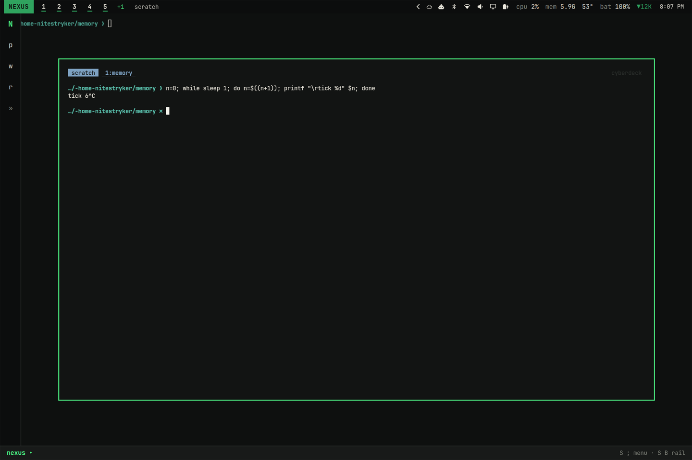

### What was added or changed

| File | Change |
|---|---|
| `~/.config/nexus/bin/nexus-scratch` | new helper: toggle / show / hide / state |
| `~/.config/nexus/scratch/tmux.conf` | new: loads your tmux config, then adds the Esc rule |
| `~/.config/hypr/nexus.lua` | new: window rule for the scratch terminal only (app-id `nexus.scratch`): special workspace, floating, centred, terminal tag |
| `~/.config/hypr/hyprland.lua` | one line added at the end: `require("hypr.nexus")` |
| `~/.config/hypr/bindings.lua` | `SUPER + `` ` `` added to the NEXUS block. It was free before |
| `~/.config/nexus/lib/Nx.js` | menu action `` ` `` scratch terminal |
| `~/.config/omarchy/plugins/nexus.rail/Rail.qml` | rail key list shows `` S ` `` |

There are no new services and nothing runs in the background. The terminal
starts the first time you press the key.

### Tested

Tests ran on workspace 9 with test windows only.

| Check | Result |
|---|---|
| First toggle starts kitty + tmux on the special workspace, shown and focused | ✓ |
| Hide returns focus to the previous window (matching window address) | ✓ |
| A running loop (`tick` counter) keeps counting while hidden. The same window comes back, and no duplicate opens | ✓ |
| Esc while a program runs passes through, so the terminal stays shown | ✓ |
| Esc at the shell prompt hides it | ✓ |
| Shown over a full-screen window, and the full-screen state survives hiding it again (screenshot above) | ✓ |
| Switching workspace while shown hides it, and a toggle brings it back on the new workspace | ✓ |
| Closing the window keeps the session (`sleep 999` still running). The next toggle reattaches with 1 window | ✓ |
| `exit` ends the session and the window closes. The next toggle starts fresh in `~` | ✓ |
| 6 rapid toggles, and 3 toggles fired at the same time: always exactly 1 window | ✓ |
| Menu key `` ` `` opens it | ✓ |
| Normal kitty windows: still tiled on their own workspaces, unchanged | ✓ |
| `hyprctl configerrors` empty, shell restarted without errors | ✓ |


**Known limit:** if a shell loop is running between two commands at the
exact moment you press `Esc`, the scratch terminal may hide. The loop keeps
running, so nothing is lost.


## 2. Project resume and git context

Get back into a project with one key. Each project row now shows its git
state and whether a session is waiting.

### How to use it

| Where | Key | What happens |
|---|---|---|
| Projects list (`Search ;` → `p`) | `r` | **Resume** the highlighted project |
| Projects list | `d` | Diff of the highlighted project |
| A project's panel (`Search ;` → `p` → number) | `r` / `d` | Resume / diff |
| Rail with keyboard focus (`Search Alt B`) | `r` / `d` | Resume / diff the highlighted project |

**What Resume does**, depending on the project's state:

| Project state | Resume |
|---|---|
| The session is already shown in a terminal | Focuses that terminal. It never opens a second one |
| The session is running but no terminal shows it | Opens one terminal attached to it |
| No session, but a saved layout (after logout or reboot) | Rebuilds the layout: same windows and names, same split panes, each pane in its old folder, nvim reopened with its files. Then it attaches |
| No session and nothing saved | New session: window `edit` runs nvim, window `shell` is a shell, both in the project folder |

A notification says which of these happened.

**Nothing is restarted automatically.** If a pane was running a dev server, a
build or a watcher, Resume gives that pane a shell in the same folder and the
notification lists it, e.g. *"Not restarted: python3 in ~/web app"*. Run it
again yourself, or use the project's task numbers.

**Project row markers** appear in the menu and the rail:

| Marker | Meaning |
|---|---|
| `main ✓` | branch, clean |
| `main ●3` | 3 changed, staged or new files |
| `!1` | merge conflicts |
| `↑2` `↓1` | commits ahead of / behind the upstream |
| `detached 3e395ff` | detached HEAD, at that commit |
| `▶ open` / `◆ running` / `◇ saved` | session shown in a terminal / running in the background / only a saved layout |
| `missing · <path>` | the folder doesn't exist. Resume says so and does nothing |
| (path only) | not a git repo, no session |

The project panel shows the full wording (`master · 1 changed · 1 new`).

- **Git refresh:** git status updates every time the menu opens and every
  16 s while the rail is expanded.
- **Diff:** opens a terminal with `git diff HEAD`, staged and unstaged
  together, followed by a list of untracked files. In a repo with no commits
  yet it shows the staged changes.
- **Non-git folders:** `d` and `g` (lazygit) say "not a git repository"
  instead of opening.

### What survives logout or reboot

| Kept | Not kept |
|---|---|
| Each project's window list, names, split layout and pane folders (`~/.local/state/nexus/sessions/<project>.json`) | Running programs: servers, builds, watchers, REPLs (listed, not restarted) |
| Which panes ran nvim (nvim is reopened) | Terminal scrollback and pane-local shell state (variables, activated venvs) |
| nvim's open files and splits, from LazyVim's session for that folder. Now saved whenever a file is opened or written, not only on a clean quit | **Unsaved nvim changes.** A session never holds those. nvim's own swap-file recovery may offer them back |

If tmux itself is still running (for example after a logout without a
reboot), Resume reattaches the real session, programs and all.

### Commands

```bash
nexus-dev resume DIR      # same as r
nexus-dev diff DIR        # same as d
nexus-dev save NAME       # write a session's layout now (also happens automatically)
nexus-dev forget DIR      # delete the saved layout; the folder is untouched
```

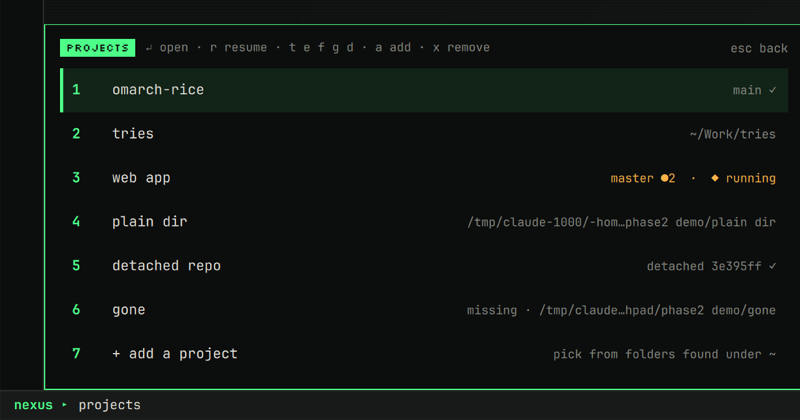
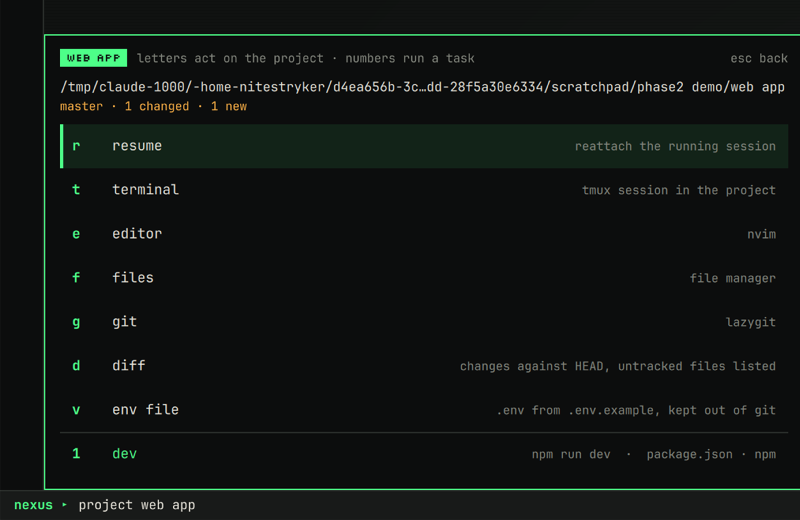
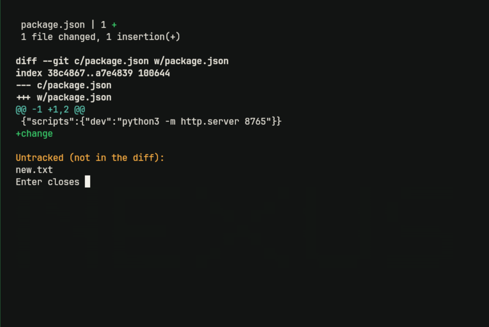

### What was added or changed

| File | Change |
|---|---|
| `~/.config/nexus/bin/nexus-dev` | new `resume`, `save`, `forget`, `diff`. `info` now reports each project's session state. `term` focuses an open terminal instead of opening a second one. `git` refuses non-git folders. Launched windows no longer inherit the lock |
| `~/.config/nexus/lib/Nx.js` | `gitCompact`, `sessionMark`, `projectSub` for the row markers |
| `~/.config/omarchy/plugins/nexus.command/Command.qml` | `r` resume and `d` diff in the projects list and project panel, plus the new row markers |
| `~/.config/omarchy/plugins/nexus.rail/Rail.qml` | row markers, `r`/`d` keys, and a 60 s snapshot of NEXUS project sessions (reads tmux only) |
| `~/.config/nvim/lua/plugins/nexus-dev.lua` | persistence.nvim also saves the session when files are opened or written |
| `~/.config/nexus/bin/nexus-scratch` | same lock fix (found while testing resume) |

**How snapshots are kept up to date:**
- **tmux hooks** fire when a window or pane is created, closed or renamed,
  when the active window changes, and when a terminal detaches. They are set
  only on NEXUS project sessions, never on your other tmux sessions.
- **A 60 s timer in the rail** catches `cd` and programs started inside a
  pane. It is the only new periodic work. It runs `tmux list-panes`, which
  takes a few milliseconds.

### Tested

Tests ran with throw-away projects whose paths contain spaces:

- a dirty git repo with a `dev` server task
- a plain folder
- a detached-HEAD repo
- a deleted folder

| Check | Result |
|---|---|
| Info: dirty (`master ●2`), non-git (path only), detached (`detached 3e395ff`), missing (`missing · …`) | ✓ |
| First resume: new session with `edit` (nvim) and `shell`, one terminal | ✓ |
| Resume again, and two resumes at the same time: still one session and one terminal | ✓ |
| Resume of an already-open project focuses its terminal (0.09 s) | ✓ |
| Hooks keep the snapshot current (new window, split pane in `.git`, rename to `devserver`) | ✓ |
| Simulated logout (session killed): resume rebuilds all 3 windows, the split, the folders and nvim | ✓ |
| A dev server on port 8765 was running before the kill. After resume it is **not** running, and the notification lists it | ✓ |
| nvim killed without quitting, as at logout: resume reopens `package.json` | ✓ |
| Missing folder: notification "Can't resume … doesn't exist", nothing created | ✓ |
| Diff on a dirty repo shows the change and the untracked `new.txt` (screenshot). On a non-git folder it shows a notice | ✓ |
| `r` in the project panel, typed into the NEXUS menu: resumes. The plain folder gets a new session | ✓ |
| Bug found and fixed: launched windows and the tmux server kept the resume lock, so a second resume waited 10 s | ✓ fixed |
| Config and shell load with no errors, and the project list is unchanged afterwards | ✓ |


## 3. Build and test failure inbox

Tasks you start from NEXUS that fail land in one short list, with their real
output and links to the lines they complain about.

### How to use it

1. **Start a task as before.** Open a project (`Search ;` → `p` → number) and
   press a task's number. It runs in the background job list (`j`).
2. **If it fails,** a notification says *"Task failed: my app · test · exit 2"*
   and the menu shows **`x failures 1`** in amber.
3. **Open the inbox:** `Search ;` then `x`.

**In the failures list:**

| Key | Does |
|---|---|
| `↵` or number | Details of that failure |
| `r` | Rerun the same command in the same folder. It shows up in jobs |
| `o` | Full saved output in a terminal (`less`, colours kept, opens at the end) |
| `x` | Dismiss: hide it from the inbox. It isn't marked fixed |
| `c` | Clear history: delete resolved, dismissed and replaced failures. Open ones stay |

**In a failure's details:**
- `o`, `r` and `x` work as in the list.
- **Numbered rows are file references found in the output**, such as
  `src/calc.py:5` or `src/index.ts:1:14`. Press the number to open nvim at
  that line and column.
- **The box at the bottom** shows the last lines of the output as plain text.

**How the inbox stays tidy:**
- **One entry per task.** If the same task fails again, the newer failure
  replaces the older one, which moves to history.
- **A passing run is the fix.** When the task later succeeds, its failure is
  marked *resolved by a passing run* and kept in history.
- **Dismissing is separate from fixing.** A dismissed failure is hidden but
  not resolved, and a later passing run still records the fix.
- **Cancelled isn't failed.** Stopping a job (`s` in jobs), or Ctrl-C, TERM,
  HUP or KILL, makes it *cancelled*: grey in jobs, never in the inbox.
- **History** sits below a divider, dimmed, with what happened (resolved
  20:35 / dismissed 20:35 / replaced). It shows the last 8.

**Which file references it finds:**
- Python tracebacks (`File "x.py", line 12`)
- TypeScript (`file.ts(1,14)`)
- the common `path:line:col` form used by eslint, ruff, gcc, node and others

It only lists files that exist, skips `node_modules`, `.venv`, site-packages
and system files, and stops at 20. Output with no references is still shown
in full and simply has no numbered rows.

### Storage

All of it is local, in `~/.local/state/nexus/runs/`:
- **Records:** one small JSON record per run, at most 200.
- **Logs:** one per run, capped at 1 MiB. A longer output keeps its *last*
  1 MiB, which is where the errors are.
- **Which logs are kept:** those of open failures and the 30 newest other
  runs, at most 50 MiB in total. Older logs are deleted. Their records stay
  until the 200 limit.

### Commands

```bash
nexus-task runs                 # all recorded runs (JSON)
nexus-task rerun RUN            # same as r
nexus-task dismiss RUN          # same as x
nexus-task history-clear        # same as c
nexus-task refs RUN             # the file references (JSON)
nexus-task output RUN           # same as o
```

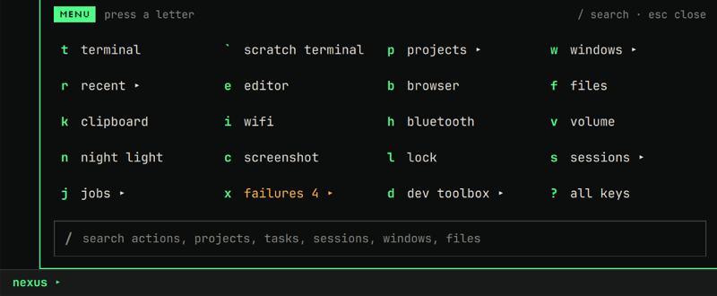
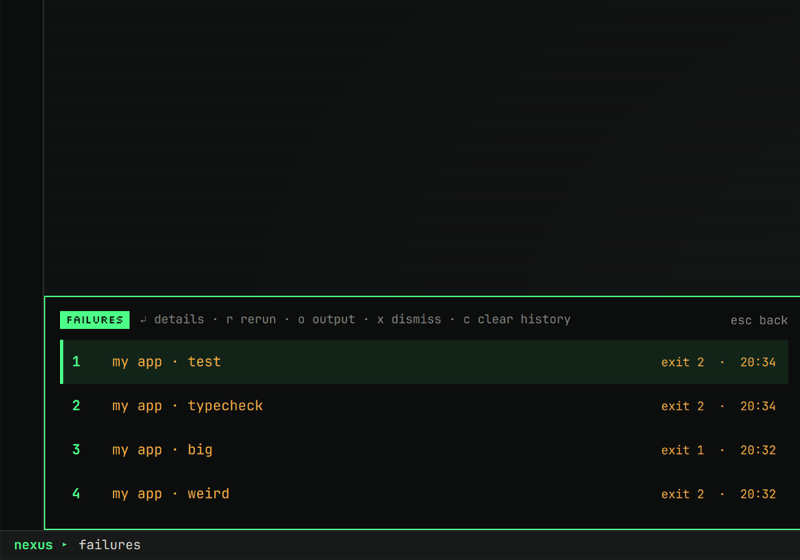

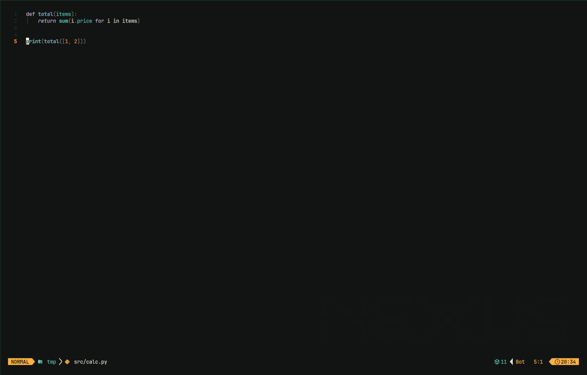
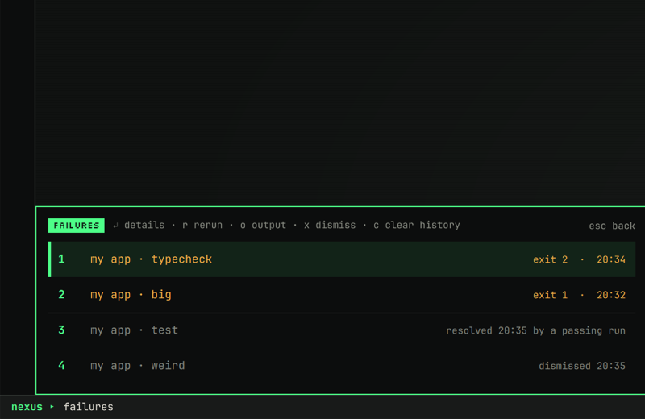

### What was added or changed

| File | Change |
|---|---|
| `~/.config/nexus/bin/nexus-task-run` | new: runs a task in its tmux window, copies the output to the log (tmux `pipe-pane`, so the program keeps its terminal) and records the exit |
| `~/.config/nexus/bin/nexus-task` | runs are recorded. `stop` marks them cancelled. New `finish`, `runs`, `rerun`, `dismiss`, `history-clear`, `refs`, `output`, `log-tail`, `open-ref`. Storage limits |
| `~/.config/nexus/lib/Nx.js` | menu action `x failures`, cancelled state for jobs, small helpers |
| `~/.config/omarchy/plugins/nexus.command/Command.qml` | failures list, failure details, amber count in the menu, tasks pass their id. IPC `omarchy-shell nexus failures` |

No services or timers were added. Records are written when a task starts
and ends.

### Tested

The test project had paths with spaces and four `make` tasks: a Python crash,
TypeScript-style errors, odd output with no file names, and a slow task.

| Check | Result |
|---|---|
| Three failing tasks: each recorded once, with exit code and time, and one notification each | ✓ |
| References: `src/calc.py:5` and `:2` from the traceback, `src/index.ts:1:14` from the tsc line. The odd output gives none and is still readable | ✓ |
| Stopping a running task makes it **cancelled** (`stopped`). Ctrl-C makes it **cancelled**. Neither appears in the inbox. Jobs show them grey | ✓ |
| Rerunning a still-failing task: the inbox keeps one entry, and the old one is marked replaced | ✓ |
| Fixed, then rerun from the menu (`r`): the failure is resolved by the passing run, the inbox drops it, and history shows "resolved 20:35" | ✓ |
| Dismiss (`x`): hidden, recorded as dismissed, **not** resolved | ✓ |
| Clear history (`c`): resolved, dismissed and replaced records deleted; open failures kept | ✓ |
| 3.8 MB of output: log trimmed to its last 1 MiB, last line intact | ✓ |
| Menu: the `x failures 4` badge, the inbox, details and the output preview (screenshots) | ✓ |
| Number on a reference: nvim opens `src/calc.py` at 5:1. `o`: `less` with the full traceback in colour | ✓ |
| Starting a task from the project panel records its task id (`make:weird`) | ✓ |
| Bug found and fixed: colour codes showed in the output preview | ✓ fixed |
| Config and shell load with no errors, test runs, windows and project removed afterwards | ✓ |


## 4. Search across projects and tools

One search for actions, projects, files, notes, tasks, sessions, jobs and
windows, grouped so you can see what kind of thing each result is. Plus a
deliberate search *inside* a project's files.

### How to use it

| Do this | What happens |
|---|---|
| `Search ;` then `/`, or `Shift` + overview key | **Search everything.** Every key you type is text, never a shortcut |
| `↑` `↓` (or `Tab`), `↵`, or tap a row | Move, open, or open by touch |
| `Esc` | Back to the menu (or back to the project, see below) |
| In a project's panel: `/` | **Search text inside that project's files** |
| In search, on a project result: `Ctrl ↵` | Same, without opening the project first |

**Results come in groups,** each labelled on the left with a line between
groups. Each group shows its best few matches, so one busy group can't push
the others off:

| Group | What | Opening it |
|---|---|---|
| actions | the menu's actions (terminal, wifi, lock…) | runs it |
| projects | your projects with git and session markers | opens the project panel |
| tasks | tasks from your projects' manifests | runs the task |
| files | recent files, then file names inside your **listed projects** | recent: default app. Project file: nvim in that project |
| notes | note files (`.md`, `.txt`, `.org`) by name | nvim |
| sessions / jobs / windows | tmux sessions, NEXUS jobs, open windows | attach / output / focus |

- **Empty search:** shows your projects, recent files, sessions and jobs, so
  `/` then `↵` is a quick way back to recent work.
- **No match:** says so, and points to `/` inside a project.
- **Text search inside a project:** lists `file:line` and the matching
  line. `↵` opens nvim at that exact line and column. It needs at least
  2 letters. `Esc` goes back to the project.

**Notes:** set your note folders in `~/.config/nexus/identity.toml`:

```toml
[search]
notes = "~/Notes, ~/Documents/Journal"
```

Without that setting NEXUS uses `~/Notes` or `~/notes` if they exist, plus
any Obsidian vaults. You don't have a notes folder yet, so the notes group
stays empty until you set one.

### What search never does

- **Never searches your whole home folder.** File names are searched only
  inside the projects listed in `identity.toml` and your note folders.
  Contents are searched only in the one project you chose.
- **Never shows ignored or hidden files.** It respects `.gitignore` and other
  ignore files and skips hidden files and folders (so also `node_modules`,
  `dist`, `.venv`, `.git`).
- **Never shows credential files,** even ones git doesn't ignore: `.env*`,
  `*.pem`, `*.key`, `*.p12`, `*.pfx`, `*.kdbx`, `*.gpg`, `*.asc`, SSH keys,
  `.netrc`, `.npmrc`, `.pypirc`, `.git-credentials`, `*credential*`,
  `*secret*`, `*.keystore`, `*.jks`. That covers file-name search and
  text search.
- **Never runs anything** from a project. It only uses `fd` and `ripgrep` to
  read names and text.
- **Never piles up.** It waits 150 ms after you stop typing. A new keystroke
  kills the search still running (its whole process tree), and a result is
  only shown if it belongs to the current text. Every search also stops
  after 3 s.
- **Caps results:** 40 files, 20 notes and 60 text lines are fetched, and
  14 rows are shown (12 for text).

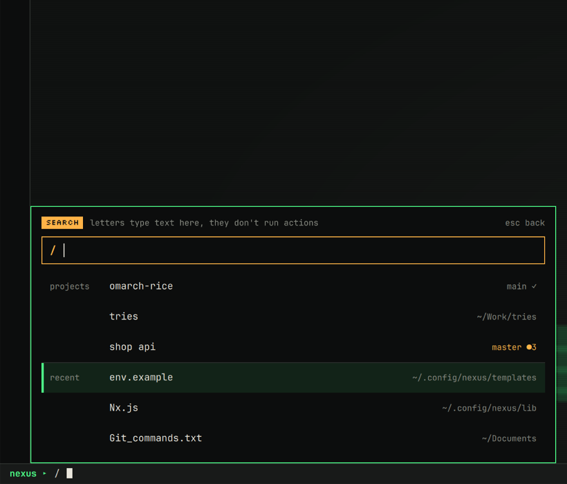
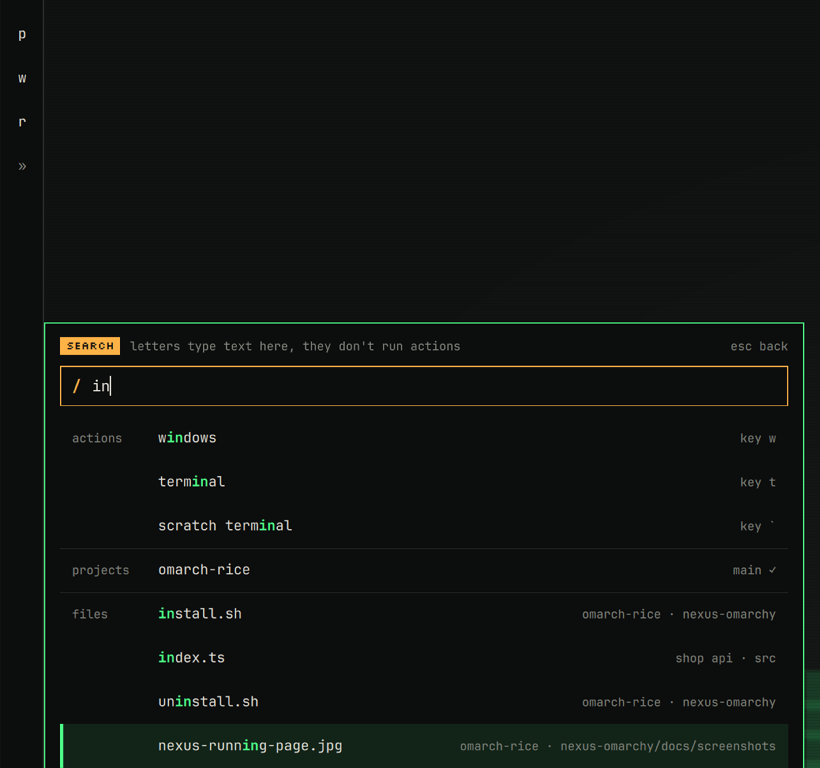
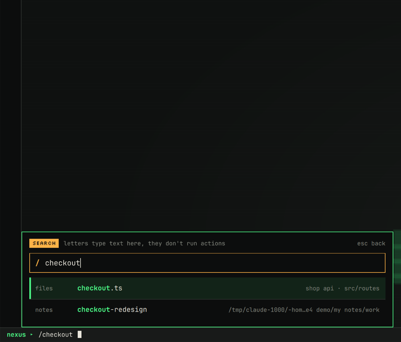
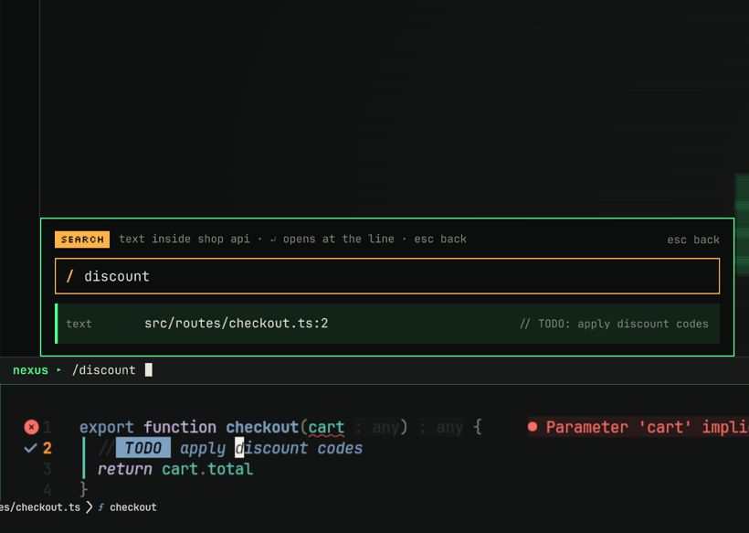
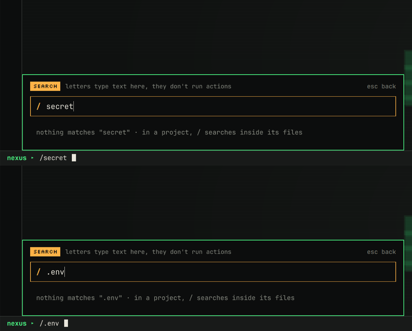

### What was added or changed

| File | Change |
|---|---|
| `~/.config/nexus/bin/nexus-search` | new: `files`, `notes`, `text`, `notes-dirs`. Secret exclusions, caps, 3 s timeout, kills its whole process tree when cancelled |
| `~/.config/omarchy/plugins/nexus.command/Command.qml` | grouped results, live file and note search, text search inside a project (`/` in the panel, `Ctrl ↵` in search), empty and no-match states |

No services and no index. Nothing runs until you type in search.

### Tested

The test project was `shop api` (path with spaces). Its git repo has
`node_modules/` and `dist/` ignored, plus `.env` (`STRIPE_KEY=sk_test_…`),
`db-secret.txt` and `server.pem`. The test notes folder held two `.md` files.

| Check | Result |
|---|---|
| File-name search `checkout`: only `src/routes/checkout.ts`. The copies in `node_modules`, `dist`, `.env`, `db-secret.txt` and `server.pem` are not shown | ✓ |
| Text search `checkout`: only the two real source lines | ✓ |
| Searching `secret` or `.env` finds nothing. Text search for `sk_test` (the value inside `.env`) finds nothing | ✓ |
| Notes: the configured folder is found, `checkout-redesign.md` matches, missing folders are skipped | ✓ |
| Menu, `checkout`: grouped **files** and **notes** rows with the project and path shown (screenshot) | ✓ |
| Menu, `in`: actions / projects / files / windows groups, each capped, with dividers (screenshot) | ✓ |
| Empty search shows projects, recent files and so on. No match shows a hint | ✓ |
| `↵` on a file result opens nvim | ✓ |
| Panel `/`, then `discount`: `src/routes/checkout.ts:2`. `↵` opens nvim at 2:18, on the word | ✓ |
| `Ctrl ↵` on a project result switches to text search inside it | ✓ |
| `Esc` in project text search returns to the project panel | ✓ |
| Typing 14 letters at 30 ms intervals: no searches during typing, one at the end, none left running | ✓ |
| **Bug found and fixed:** a new keystroke stopped the old search script but not its `fd`/`rg`. Now the next key kills the old `rg` at once (verified in the menu on a large folder) | ✓ fixed |
| Config and shell load cleanly, test project and notes setting removed | ✓ |


## 5. Terminal greeting

New terminals open with a small NEXUS mark and two lines about where you are.
Your prompt is unchanged.


### What you see

**A new terminal window in a project** (a listed project, a git repo, or a
folder with tasks) shows two lines:

```
█▄ █ ██▀ ▀▄▄▀ █  █ ▄█▀▀   omarch-rice · main ✓
█ ▀█ █▄▄ ▄▀▀▄ ▀▄▄▀ ▄▄█▀   tasks: dev, test, build, lint +2 · 1 failed (SUPER ; x)
```

- **Line 1:** the project name and git state, in the same markers as the menu:
  `main ✓` clean, `●3` changes, `↑1 ↓2`, `detached a1b2c3d`, `!1`
  conflicts, or `no git`.
- **Line 2:** the first tasks found in its manifests, open failures from the
  failure inbox (section 3), and `tmux session running` or `saved layout` if Resume has
  something waiting. With no tasks it shows the folder instead.
- **Outside a project** (for example `~`) the lines are the folder, how many
  projects and tmux sessions you have, and `SUPER ; menu`.

**Repeated panes stay quiet:**
- **tmux panes and windows** never show the mark. Inside a project they show
  only the two summary lines; anywhere else they show nothing. Splitting
  panes or opening tmux windows never piles up branding.
- **A shell started from a shell** (typing `bash`) and **nvim's
  `:terminal`** show nothing.
- **Scripts and non-interactive shells** print nothing.

**Narrow windows:** below about 45 columns the mark is dropped, and lines are
cut with `…` to fit, so nothing wraps. With `NO_COLOR` set there is no
colour.

### Settings

In `~/.config/nexus/identity.toml`:

```toml
[terminal]
greeting = "full"      # mark + summary (current)
greeting = "summary"   # the two lines, never the mark
greeting = "off"       # nothing
```

For a single shell: `NEXUS_GREETING=off bash`. The greeting is separate from
the prompt: turning it off leaves starship exactly as it is, and the prompt
is not changed by NEXUS.

### Cost

- **Speed:** about 30 ms per new terminal (55 ms vs 23 ms for a bare
  interactive bash in a pseudo-terminal), with a hard limit of 0.4 s for
  reading the project.
- **No network:** output is identical with networking removed entirely
  (`unshare -rn`).
- **No project code runs:** it reads `git status` (with `--no-optional-locks`,
  so it never takes git's lock) and manifest files through `nexus-dev info`.
- **Nothing in the background.**

### What was added or changed

| File | Change |
|---|---|
| `~/.config/nexus/shell/greeting.bash` | new: the greeting (sourced, interactive shells only) |
| `~/.bashrc` | 4 lines at the end that source it |
| `~/.config/nexus/identity.toml` | new `[terminal]` section with `greeting = "full"` |

### Tested

| Check | Result |
|---|---|
| Real kitty window in `~/omarch-rice`: mark + `omarch-rice · main ✓` + folder, then the usual prompt (screenshot) | ✓ |
| Project with tasks: `tasks: slow, test, typecheck, weird`. With an open failure: `· 1 failed (SUPER ; x)` | ✓ |
| `~` and `/tmp`: folder + `2 projects · 0 tmux sessions · SUPER ; menu` | ✓ |
| 50 columns: mark kept and line 2 cut with `…`. 30 columns: no mark, both lines fit | ✓ |
| Real tmux: two panes in the project show only the summary; a tmux window in `~` shows nothing | ✓ |
| `greeting = "off"` / `"summary"` / `"full"` through your real `.bashrc`. The prompt is identical in all three | ✓ |
| `NEXUS_GREETING=off`, nested `bash`, non-interactive `bash -c` (0 bytes), `NO_COLOR` (no colour codes) | ✓ |
| No network: identical output inside a namespace with no network | ✓ |
| A folder with no git and no tasks: harmless, shows the folder | ✓ |
| `bashrc` syntax check, test windows and tmux sessions removed | ✓ |


## 6. Wallpaper and lock screen

The desktop and the lock screen now share one look: flat charcoal, fine
scanlines, off-white corner ticks, and the NEXUS mark as real pixel art. The
lock screen gains a clock and date.

| Empty desktop | Occupied desktop | Lock screen |
|---|---|---|
| 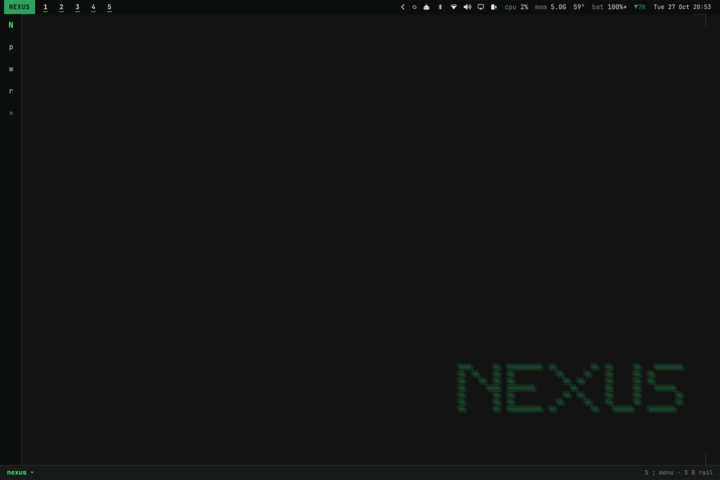 | 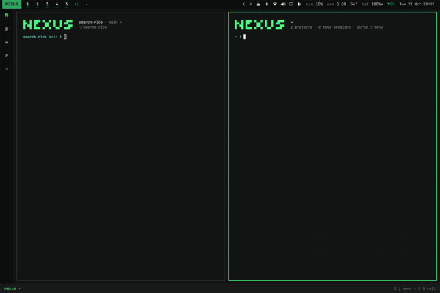 |  |

Lock screen at the panel's real resolution:

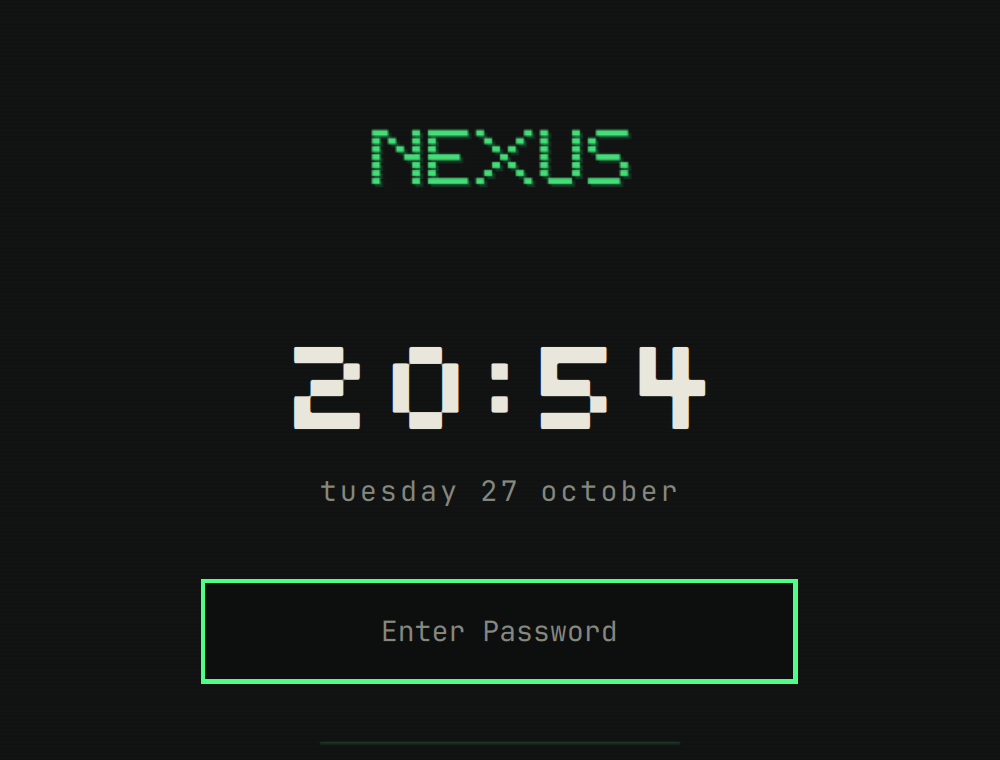

### What changed

**Wallpaper** (`backgrounds/1-nexus.png`):
- **Drawn as pixel blocks** at the panel's native 2256×1504. Each block is a
  whole number of screen pixels with a scanline gap, so the edges are sharp.
  The old wallpaper used font glyphs and was slightly soft.
- **The mark is dim and sits lower right,** where windows rarely reach. The
  rest of the screen is empty.
- **Flat charcoal, no gradient.** A dark gradient on this panel showed visible
  rings (only about 20 shades), so the background has none. The file is 17 KB.
- **The previous wallpaper is kept** as `2-nexus-classic.png`. Cycle with
  `omarchy theme bg next` or the background switcher.

**Lock image** (`lock.png`, same style):
- a small bright mark above the clock,
- a faint phosphor rule under the password field.

**Lock screen:**
- **Big pixel clock** (Silkscreen, off-white) and the date above the password
  field. The clock updates once a second with no animation.
- **Shown sharp:** the lock image is not blurred.
- **Same password field as before:** Omarchy's own, using the NEXUS `[lock]`
  colours.

### How the lock screen was changed safely

- **Supported route:** NEXUS ships `nexus.lock`, a clone of Omarchy's
  `omarchy.lock`, the same thing `omarchy plugin clone omarchy.lock` makes.
  The installer enables it and disables the original, which stays
  installed.
- **Only the view changed.** `LockView.qml` gained the lock image, clock and
  date. **`Service.qml`, which does all the authentication** (PAM, password
  and fingerprint flows, idle blanking, recovery from a stranded lock), is
  **byte-for-byte identical** to Omarchy's, checked with `cmp`. The manifest
  differs only in id and name.
- **Static fallback:** if the active theme has no `lock.png` (another theme,
  or the file is missing), the lock screen goes back to Omarchy's own look,
  the blurred current wallpaper, still with the clock. Tested by moving the
  file away.
- **Reduced motion:** nothing on the wallpaper or lock screen animates.
  `touch ~/.local/state/nexus/reduced-motion.flag`
  still turns off window animations.

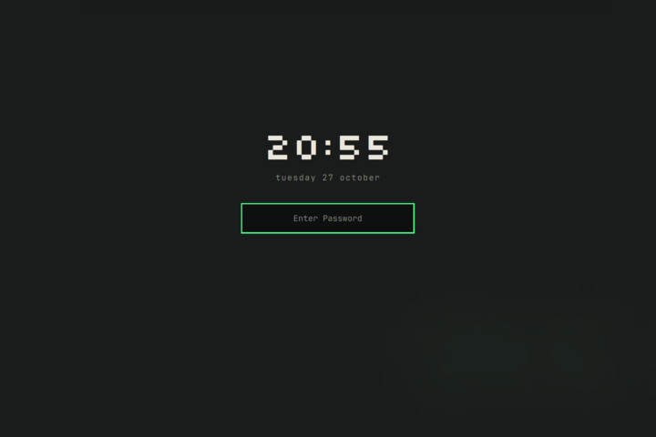

### Files

| File | Change |
|---|---|
| `~/.config/omarchy/themes/nexus/src/art.py` | new: draws the wallpaper and lock image (`art.py wallpaper|lock out.svg`) |
| `~/.config/omarchy/themes/nexus/src/render.sh` | new: rebuilds both PNGs. Afterwards run `omarchy theme set nexus` |
| `~/.config/omarchy/themes/nexus/backgrounds/1-nexus.png` | new wallpaper |
| `~/.config/omarchy/themes/nexus/backgrounds/2-nexus-classic.png` | the previous wallpaper, kept |
| `~/.config/omarchy/themes/nexus/lock.png` | new lock image |
| `~/.config/omarchy/plugins/nexus.lock/` | clone of `omarchy.lock`, `LockView.qml` changed |
| `~/.config/omarchy/shell.json` | `nexus.lock` enabled, `omarchy.lock` disabled (done by `omarchy plugin clone`) |

### Tested

| Check | Result |
|---|---|
| Wallpaper and lock image render at 2256×1504, crisp blocks, 12 colours, no banding | ✓ |
| Theme re-applied, new wallpaper selected (`current/background` → `1-nexus.png`) | ✓ |
| Lock service healthy after the clone and a shell restart: `passwordPam: true`, not locked, no errors | ✓ |
| `Service.qml` identical to Omarchy's | ✓ |
| Lock **preview** (`omarchy-shell lock preview`, which shows the real view without locking): mark, clock `20:54`, date, password field (screenshots, including native resolution) | ✓ |
| Fallback without `lock.png`: blurred wallpaper plus clock. With the file back: NEXUS image | ✓ |
| Empty desktop, occupied desktop and lock screen look related (screenshots above) | ✓ |

**Try it once yourself** before relying on it:

1. Press `Super Ctrl L`.
2. Check the clock, and that the password dots appear as you type.
3. Unlock. A wrong password shows the error state first.

**If the lock screen ever misbehaves** (unlikely: the unlocking code is
Omarchy's own):
1. Switch to a text console with `Ctrl Alt` + the `⟳` key (that's F3 on this
   keyboard).
2. Log in.
3. Run:

```bash
omarchy plugin disable nexus.lock && omarchy plugin enable omarchy.lock && omarchy restart shell
```

That puts back Omarchy's original lock screen.

