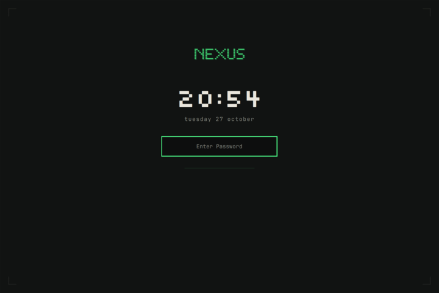
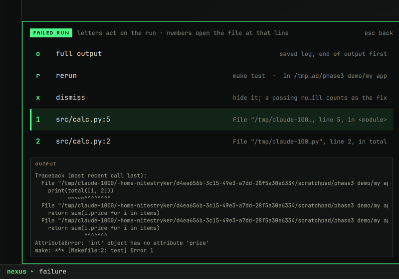

# NEXUS

A terminal-workbench theme for [Omarchy](https://omarchy.org) (Hyprland). It uses
charcoal, phosphor green, restrained amber and off-white, with a pixel
wordmark.

- **Command menu:** press `SUPER ;`. A single letter runs an action, `/` searches
  everything, and `Esc` steps back.
- **Collapsible rail:** shows your projects, the windows on the current
  workspace and your recent files.
- **Status line:** numbered workspaces (active / occupied / empty / urgent) and
  quiet system readouts.
- **Developer tools:** projects with git status, real tmux sessions, tasks found
  in `package.json`, `pyproject.toml`, `Makefile` and compose files, a job list
  with live output, stop and local server links, and a dev toolbox.
- **Scratch terminal:** `SUPER` + `` ` `` drops a persistent terminal over
  anything and hides it again. Running commands keep going.
- **Project resume:** `r` on a project reattaches its tmux session, or rebuilds
  the saved layout after a reboot. Nothing is restarted for you. Project rows
  show compact git state, and `d` shows the diff.
- **Failure inbox:** failed tasks land in one list (`x`) with their real
  output, rerun and dismiss, and `file:line` links that open nvim at the line.
- **Search:** grouped results for actions, projects, files, notes, tasks,
  sessions, jobs and windows, plus text search inside one project. Ignored and
  credential files are never shown.
- **Terminal greeting:** a two-line NEXUS mark with the project's git state,
  tasks and open failures. tmux panes stay quiet.
- **Wallpaper and lock screen:** pixel art at native resolution, and a lock
  screen with a clock and date (Omarchy's own authentication, untouched).
- **Restyled notifications** to match.
- **Touch friendly** with 40–44 px rows. No forced layouts, and no apps start on
  their own.

**Every feature is explained in [GUIDE.md](GUIDE.md)**: how to use it, what it
changes, how it was tested, with screenshots.


| Command menu | Search mode |
|---|---|
|  |  |
| **Rail collapsed, keyboard focus** | **Notifications** |
|  |  |

| **Lock screen** | **Failure inbox** |
|  |  |

More in [`docs/screenshots/`](docs/screenshots/) and [`docs/guide/`](docs/guide/).

Built and tested on Omarchy 4.0.6 / Hyprland 0.56.2 on an Acer Chromebook
Spin 13 (2256×1504 at 1.5667 scale).

## Install

```bash
git clone https://github.com/<you>/nexus-omarchy.git
cd nexus-omarchy
./install.sh --dry-run      # see what it would do
./install.sh                # install and switch to the theme
```

Options:

| Option | Adds |
|---|---|
| `--chromebook` | Top-row keys that do what their icons show, plus the Acer Spin 13 touchscreen fix in `/etc` (asks for sudo) |
| `--dev` | LazyVim language config (`nexus-dev.lua`) |
| `--no-apply` | Copy files only; don't switch the theme or restart the shell |

**Backups and marked blocks:**
- **Backups:** before any file is overwritten, the installer backs it up to
  `~/.local/share/nexus/backup-<stamp>/`.
- **Marked blocks:** these go at the end of three files, so your own content
  stays as it is:
  - `~/.config/hypr/bindings.lua`: the keys,
  - `~/.config/hypr/hyprland.lua`: one `require("hypr.nexus")` line for the
    scratch terminal's window rule,
  - `~/.bashrc`: one line for the terminal greeting.
- **`./uninstall.sh` puts everything back.**

**Notes:**
- **Bar layout:** the installer replaces `~/.config/omarchy/shell.json`.
  Your old one is in the backup.
- **Lock screen:** `shell.json` switches it to `nexus.lock`, a clone of
  Omarchy's lock with only its look changed. The original stays installed,
  and `omarchy plugin enable omarchy.lock` brings it back.

## Keys

| Keys | Action |
|---|---|
| `SUPER ;` | Command menu |
| `SUPER` + `` ` `` | Scratch terminal: show / hide |
| `SUPER B` | Collapse / expand the rail |
| `SUPER ALT B` | Keyboard focus on the rail |

In the menu:

- **Open things:** `t` terminal · `e` editor · `b` browser · `f` files
- **Lists:** `p` projects · `w` windows · `r` recent · `s` tmux sessions · `j` jobs ·
  `x` failures · `d` dev toolbox · `` ` `` scratch terminal
- **System:** `k` clipboard · `i` wifi · `h` bluetooth · `v` volume · `n` night light ·
  `c` screenshot · `l` lock · `?` all keys
- **Search:** `/` (inside search, letters are text only)

In the projects list:
- `r` resumes a project, `d` shows its diff.
- `a` adds a project, and `x` twice removes one. From a terminal:
  `nexus-project add .`.

In a project, `/` searches text inside its files.

There is a printable one-page key sheet in [`docs/NEXUS-KEYS.pdf`](docs/NEXUS-KEYS.pdf).
It shows the Chromebook layout. Every feature is covered in [GUIDE.md](GUIDE.md),
and the installed files are described in
[`home/.config/nexus/README.md`](home/.config/nexus/README.md).

## Repository layout

Each folder mirrors where its files go when installed.

```
nexus-omarchy/
├── install.sh / uninstall.sh
├── GUIDE.md                               every feature: use, files, tests
├── LICENSE                                MIT
├── home/                                  → copied into ~
│   ├── .config/
│   │   ├── omarchy/
│   │   │   ├── themes/nexus/              theme: colours, shell styling, wallpapers, lock.png, sounds
│   │   │   │   └── src/                   art.py + render.sh (pixel-art wallpaper and lock image)
│   │   │   ├── plugins/
│   │   │   │   ├── nexus.command/         command line + menu (service)
│   │   │   │   ├── nexus.rail/            collapsible rail (service)
│   │   │   │   ├── nexus.notifications/   restyled notification cards (service)
│   │   │   │   ├── nexus.lock/            lock screen: Omarchy's lock, new look (service)
│   │   │   │   ├── nexus.tag/             status-line wordmark (bar widget)
│   │   │   │   ├── nexus.workspaces/      numbered workspaces (bar widget)
│   │   │   │   └── nexus.readouts/        CPU / mem / temp / net / battery (bar widget)
│   │   │   └── shell.json                 bar layout and enabled plugins
│   │   ├── hypr/
│   │   │   ├── looknfeel.lua              borders, gaps, motion
│   │   │   ├── nexus.lua                  window rule for the scratch terminal
│   │   │   └── nexus-bindings.lua         keys (merged into bindings.lua)
│   │   └── nexus/
│   │       ├── identity.toml              your name, tagline and project list
│   │       ├── lib/Nx.js                  shared palette, actions, helpers
│   │       ├── bin/                       nexus-dev, nexus-task(-run), nexus-search, nexus-scratch,
│   │       │                              nexus-project, nexus-env, nexus-recent, nexus-telemetry
│   │       ├── scratch/tmux.conf          scratch terminal's tmux setup
│   │       ├── shell/greeting.bash        terminal greeting (sourced from ~/.bashrc)
│   │       ├── templates/env.example
│   │       └── README.md                  full guide
│   └── .local/share/fonts/nexus/          Silkscreen (SIL OFL, licence included)
├── extras/
│   ├── chromebook-spin-13/
│   │   ├── home/.config/hypr/nexus-chromebook-keys.lua   top-row keys
│   │   └── etc/modprobe.d/chromebook-touchscreen.conf    touchscreen fix → /etc
│   └── dev-workstation/home/.config/      nvim (LazyVim), mise, git ignore examples
└── docs/                                  key sheet (PDF/HTML), developer tools list,
                                           screenshots/, guide/ (GUIDE.md's images)
```

## Requirements

- Omarchy 4.x with the Quickshell-based Omarchy shell, and Hyprland with the
  Lua config.
- JetBrains Mono Nerd Font, which Omarchy ships.
- For the developer features: `git`, `tmux`, `jq`, `fd`, `ripgrep`, `nvim`,
  `lazygit`, and `kitty` for the scratch terminal. Omarchy ships most of
  these.
- `rsvg-convert` (librsvg) only if you rebuild the wallpaper with
  `themes/nexus/src/render.sh`.

## Tweaks

- **Turn animations off:** `touch ~/.local/state/nexus/reduced-motion.flag`
- **Bar on another edge:** `omarchy bar position top`
- **Name and tagline in the rail:** edit `~/.config/nexus/identity.toml`
- **Terminal greeting:** `[terminal] greeting = "full" | "summary" | "off"`
  in `identity.toml`
- **Note folders for search:** `[search] notes = "~/Notes"` in `identity.toml`
- **Previous wallpaper:** `omarchy theme bg next` (`2-nexus-classic.png`)

## License

MIT. See [`LICENSE`](LICENSE). The Silkscreen font keeps its own SIL Open Font
License.

## Credits

- `nexus.notifications` and `nexus.lock` are restyled clones of Omarchy's own
  notifications and lock plugins. The lock's authentication code is unchanged.
- Silkscreen font by Jason Kottke / The Silkscreen Project Authors, SIL Open Font License (see `OFL.txt`).
