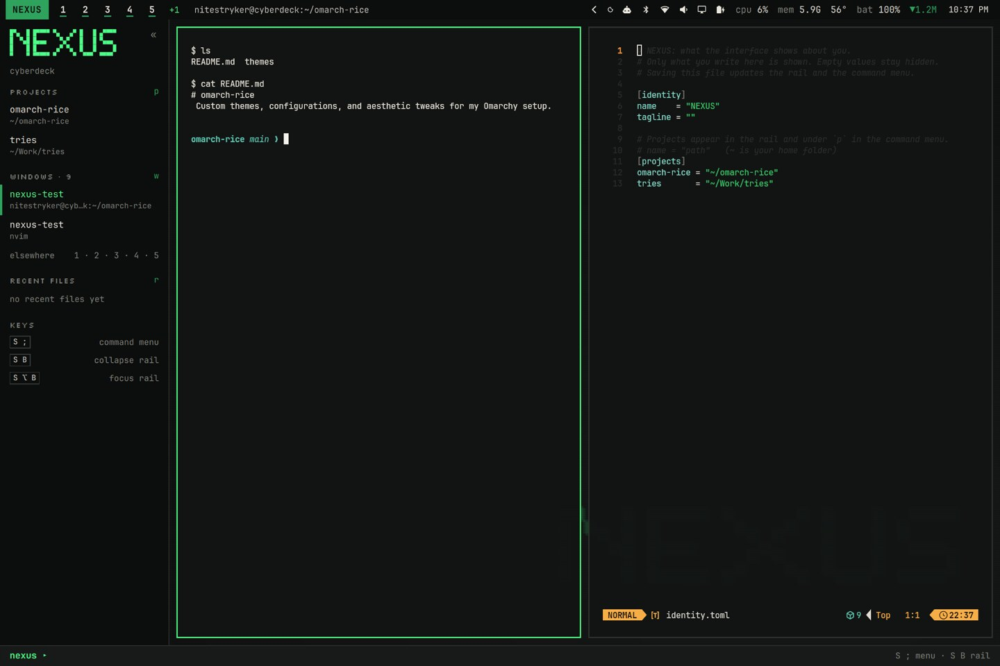
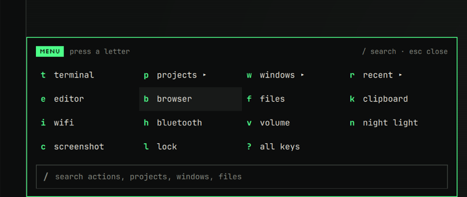
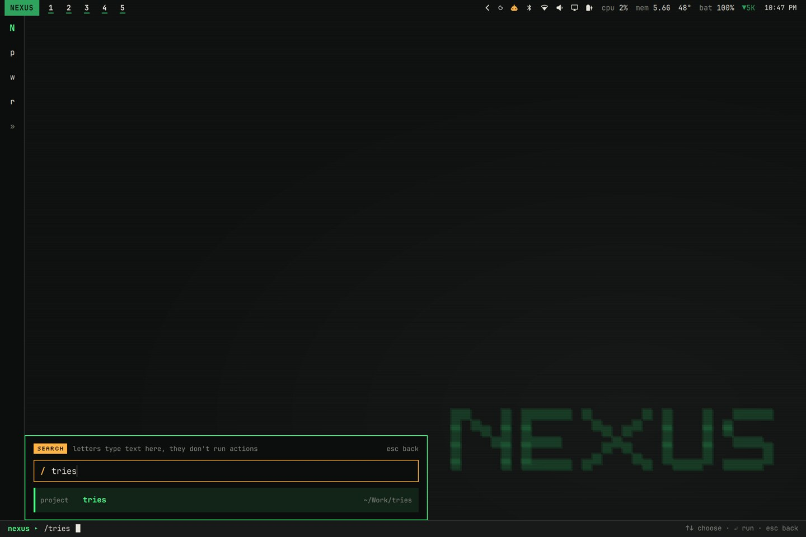
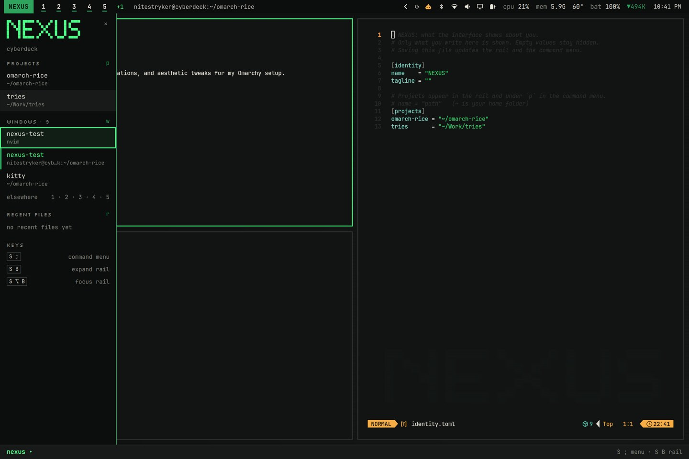
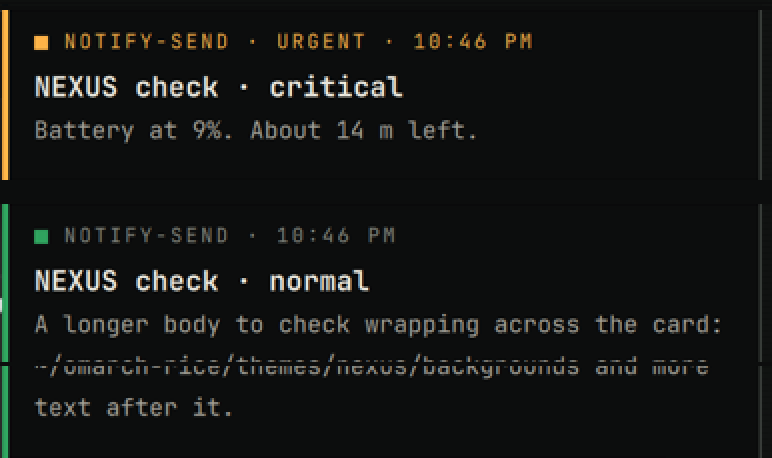

# NEXUS

A terminal-workbench theme for [Omarchy](https://omarchy.org) (Hyprland). It uses
charcoal, phosphor green, restrained amber and off-white, with a pixel
wordmark.

- **Command menu:** press `SUPER ;`. A single letter runs an action, `/` searches
  everything, and `Esc` steps back.
- **Collapsible rail:** shows your projects, the windows on the current
  workspace and your recent files.
- **Status line:** numbered workspaces (active / occupied / empty / urgent) and
  quiet system readouts.
- **Developer tools:** projects with git status, real tmux sessions, tasks found
  in `package.json`, `pyproject.toml`, `Makefile` and compose files, a job list
  with live output, stop and local server links, and a dev toolbox.
- **Restyled notifications** to match.
- **Touch friendly** with 40–44 px rows. No forced layouts, and no apps start on
  their own.



| Command menu | Search mode |
|---|---|
|  |  |
| **Rail collapsed, keyboard focus** | **Notifications** |
|  |  |

More in [`docs/screenshots/`](docs/screenshots/), including the projects list,
urgent workspaces, and a full page of the theme running.

Built and tested on Omarchy 4.0.6 / Hyprland 0.56.2 on an Acer Chromebook
Spin 13 (2256×1504 at 1.5667 scale).

## Install

```bash
git clone https://github.com/<you>/nexus-omarchy.git
cd nexus-omarchy
./install.sh --dry-run      # see what it would do
./install.sh                # install and switch to the theme
```

Options:

| Option | Adds |
|---|---|
| `--chromebook` | Top-row keys that do what their icons show, plus the Acer Spin 13 touchscreen fix in `/etc` (asks for sudo) |
| `--dev` | LazyVim language config (`nexus-dev.lua`) |
| `--no-apply` | Copy files only; don't switch the theme or restart the shell |

Before any file is overwritten, the installer backs it up to
`~/.local/share/nexus/backup-<stamp>/`. It adds its keys as a marked block at
the end of `~/.config/hypr/bindings.lua`, so your own bindings stay as they
are. **`./uninstall.sh`** puts everything back.

Note: the installer replaces `~/.config/omarchy/shell.json` (the bar layout).
Your old one is in the backup.

## Keys

| Keys | Action |
|---|---|
| `SUPER ;` | Command menu |
| `SUPER B` | Collapse / expand the rail |
| `SUPER ALT B` | Keyboard focus on the rail |

In the menu:

- **Open things:** `t` terminal · `e` editor · `b` browser · `f` files
- **Lists:** `p` projects · `w` windows · `r` recent · `s` tmux sessions · `j` jobs ·
  `d` dev toolbox
- **System:** `k` clipboard · `i` wifi · `h` bluetooth · `v` volume · `n` night light ·
  `c` screenshot · `l` lock · `?` all keys
- **Search:** `/` (inside search, letters are text only)

In the projects list, `a` adds a project and `x` twice removes one. You can
also do it from a terminal with `nexus-project add .`.

There is a printable one-page key sheet in [`docs/NEXUS-KEYS.pdf`](docs/NEXUS-KEYS.pdf).
It shows the Chromebook layout. The full guide is
[`home/.config/nexus/README.md`](home/.config/nexus/README.md).

## Repository layout

Each folder mirrors where its files go when installed.

```
nexus-omarchy/
├── install.sh / uninstall.sh
├── LICENSE                                MIT
├── home/                                  → copied into ~
│   ├── .config/
│   │   ├── omarchy/
│   │   │   ├── themes/nexus/              theme: colors, shell styling, wallpaper, sounds, sources
│   │   │   ├── plugins/
│   │   │   │   ├── nexus.command/         command line + menu (service)
│   │   │   │   ├── nexus.rail/            collapsible rail (service)
│   │   │   │   ├── nexus.notifications/   restyled notification cards (service)
│   │   │   │   ├── nexus.tag/             status-line wordmark (bar widget)
│   │   │   │   ├── nexus.workspaces/      numbered workspaces (bar widget)
│   │   │   │   └── nexus.readouts/        CPU / mem / temp / net / battery (bar widget)
│   │   │   └── shell.json                 bar layout and enabled plugins
│   │   ├── hypr/
│   │   │   ├── looknfeel.lua              borders, gaps, motion
│   │   │   └── nexus-bindings.lua         keys (merged into bindings.lua)
│   │   └── nexus/
│   │       ├── identity.toml              your name, tagline and project list
│   │       ├── lib/Nx.js                  shared palette, actions, helpers
│   │       ├── bin/                       nexus-dev, nexus-task, nexus-project, nexus-env, …
│   │       ├── templates/env.example
│   │       └── README.md                  full guide
│   └── .local/share/fonts/nexus/          Silkscreen (SIL OFL, licence included)
├── extras/
│   ├── chromebook-spin-13/
│   │   ├── home/.config/hypr/nexus-chromebook-keys.lua   top-row keys
│   │   └── etc/modprobe.d/chromebook-touchscreen.conf    touchscreen fix → /etc
│   └── dev-workstation/home/.config/      nvim (LazyVim), mise, git ignore examples
└── docs/                                  key sheet (PDF/HTML), developer tools list, screenshots/
```

## Requirements

- Omarchy 4.x with the Quickshell-based Omarchy shell, and Hyprland with the
  Lua config.
- JetBrains Mono Nerd Font, which Omarchy ships.
- For the developer features: `git`, `tmux`, `jq`, `fd`, `nvim`, `lazygit`.
  All except lazygit come with Omarchy.

## Tweaks

- **Turn animations off:** `touch ~/.local/state/nexus/reduced-motion.flag`
- **Bar on another edge:** `omarchy bar position top`
- **Name and tagline in the rail:** edit `~/.config/nexus/identity.toml`

## License

MIT. See [`LICENSE`](LICENSE). The Silkscreen font keeps its own SIL Open Font
License.

## Credits

- `nexus.notifications` is a restyled clone of Omarchy's own notifications plugin.
- Silkscreen font by Jason Kottke / The Silkscreen Project Authors, SIL Open Font License (see `OFL.txt`).
